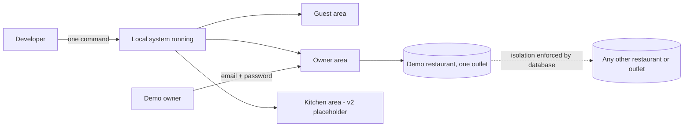

# Mission Specification: Project Foundation

**Mission Branch**: `feat/project-foundation`  
**Created**: 2026-11-16  
**Status**: Draft  
**Input**: User description: "Project foundation for Mise & Place. Set up the skeleton every later feature builds on: one repo with a web frontend and a backend plus a local database; Axis-based frontend with guest, owner and kitchen (v2 placeholder) areas; empty Core, Ordering, Payments, Records modules; multi-tenant base with restaurant and outlet scoping and database-enforced isolation; owner email + password sign-in with reserved staff/kitchen roles; per-outlet feature flags with a check helper; seed data for one demo restaurant with one outlet; lint, format, tests on both sides and a one-command local start. Out of scope: menus, ordering, payments, deployment, PWA."

## Domain Language

| Canonical term | Meaning | Avoid |
|----------------|---------|-------|
| Restaurant | The business account that owns one or more outlets | "tenant" in user-facing text, "brand" |
| Outlet | One physical location of a restaurant; the unit that owns tables, settings and feature flags | "branch", "store", "location" |
| Owner | The role of the person who manages a restaurant and its outlets | "admin", "manager" |
| Reserved role | A role value that exists in the system (staff, kitchen) but has no pages or behaviour yet | "disabled role" |
| Feature flag | A per-outlet switch that turns a capability on or off | "plan check", "tier check" |
| Route area | A top-level section of the web app for one audience (guest, owner, kitchen) | "module" (reserved for backend modules) |
| Module | A backend unit split by job (Core, Ordering, Payments, Records) | "service", "microservice" |

## Visual Overview

## User Scenarios & Testing *(mandatory)*

### User Story 1 - Start the whole system with one command (Priority: P1)

As the developer, I start the entire local system, including the database with demo data, with a single command and see all three route areas respond.

**Why this priority**: Nothing else can be built, demoed or tested until the system starts reliably from a clean checkout.

**Independent Test**: On a clean checkout with the documented prerequisites installed, run the single start command and open the guest, owner and kitchen areas.

**Acceptance Scenarios**:

1. **Given** a clean checkout and prerequisites installed, **When** the developer runs the one start command, **Then** the database, backend and frontend are all running and reachable without any further manual step.
2. **Given** the system is running, **When** the developer opens the guest, owner and kitchen areas, **Then** each loads; the kitchen area shows a clear "coming in v2" placeholder.
3. **Given** the system was started before, **When** the developer runs the start command again, **Then** it succeeds without duplicating demo data.

---

### User Story 2 - Demo owner signs in and sees their outlet (Priority: P1)

As the demo owner, I sign in with email and password and reach the owner area, where I see my restaurant and its single outlet.

**Why this priority**: Sign-in plus a visible, correctly scoped outlet is the smallest end-to-end proof that identity, scoping and the interface work together.

**Independent Test**: Sign in as the seeded demo owner; confirm the owner area shows the demo restaurant and its one outlet; confirm signed-out visitors cannot reach the owner area.

**Acceptance Scenarios**:

1. **Given** the seeded demo owner, **When** they submit the correct email and password, **Then** they land in the owner area and see the demo restaurant and its outlet.
2. **Given** a visitor who is not signed in, **When** they open an owner-area page, **Then** they are sent to sign-in and see no restaurant data.
3. **Given** a wrong password, **When** the owner submits the form, **Then** sign-in fails with a clear message that does not reveal whether the email exists.
4. **Given** a user holding a reserved role (staff or kitchen), **When** they try to use the owner area, **Then** access is denied, because reserved roles carry no pages yet.

---

### User Story 3 - One restaurant can never see another's data (Priority: P1)

As the product owner, I need the database itself to prevent any restaurant or outlet from reading or writing another's records, even if application code makes a mistake.

**Why this priority**: A cross-restaurant data leak is the costliest failure for this product; this guarantee must exist before any feature stores real data.

**Independent Test**: Create a second restaurant and outlet in a test fixture; run tests that attempt cross-restaurant and cross-outlet reads and writes through every tenant-owned table, including with deliberately unscoped queries.

**Acceptance Scenarios**:

1. **Given** data for restaurants A and B, **When** a request scoped to A queries any tenant-owned table, **Then** only A's rows are returned.
2. **Given** a request scoped to restaurant A, **When** it tries to insert or update a row carrying B's identifiers, **Then** the database rejects it.
3. **Given** a query that forgets to filter by restaurant, **When** it runs under a scoped request, **Then** it still returns only the scoped restaurant's rows.
4. **Given** a new tenant-owned table, **When** it is added later, **Then** it cannot be considered done without restaurant and outlet identifiers and an isolation rule (checked by a test that scans all tenant-owned tables).

---

### User Story 4 - Flip a feature flag per outlet and see behaviour change (Priority: P2)

As the developer, I turn a feature flag on or off for one outlet and see a gated behaviour change for that outlet only.

**Why this priority**: Pricing and rollout depend on flags from day one; the foundation must prove the check works without tying code to plan names.

**Independent Test**: Toggle a demo flag for the demo outlet and confirm a flag-gated piece of the owner area appears or disappears; confirm another outlet's flag state is unaffected.

**Acceptance Scenarios**:

1. **Given** a flag that is off for the demo outlet, **When** the owner area is loaded, **Then** the gated element is absent.
2. **Given** the same flag turned on for that outlet, **When** the owner area is loaded, **Then** the gated element is present.
3. **Given** an unknown flag name, **When** it is checked, **Then** the result is "off" and no error reaches the user.

---

### User Story 5 - Quality tooling guards every later change (Priority: P2)

As the developer, I can run lint, format and tests for both frontend and backend with simple commands, so later work starts with a working safety net.

**Why this priority**: The charter requires typecheck and lint to pass before merge and mandates tests for tenant isolation; the tooling must exist before features do.

**Independent Test**: Run the lint, format-check and test commands on a clean checkout and confirm each succeeds and each fails when a deliberate violation is introduced.

**Acceptance Scenarios**:

1. **Given** a clean checkout, **When** the developer runs the lint, format-check, type-check and test commands for each side, **Then** all pass.
2. **Given** a deliberately introduced lint or type error, **When** the same commands run, **Then** they fail and name the problem.

---

### Edge Cases

- The local database is not running or the port is already in use when the start command runs: the command stops with a clear, actionable message.
- Demo seed is run twice: no duplicate restaurant, outlet, owner or flags.
- A signed-in owner's session expires while on an owner page: they are returned to sign-in without data being shown.
- A request arrives with no restaurant or outlet scope: it sees no tenant-owned rows rather than all rows.
- A feature flag exists for an outlet that is later removed: the flags for that outlet are removed with it and never affect another outlet.
- The Axis design system package is unavailable: setup fails early with a message naming the missing dependency.

## Requirements *(mandatory)*

### Functional Requirements

| ID | Title | User Story | Priority | Status |
|----|-------|------------|----------|--------|
| FR-001 | One-command local start | As the developer, I want one command that starts the database, backend and frontend with demo data so that I can run the whole system without manual setup. | High | Open |
| FR-002 | Single repository with two applications | As the developer, I want the frontend and backend in one repository so that changes spanning both are made and reviewed together. | High | Open |
| FR-003 | Three route areas | As a user, I want separate guest, owner and kitchen areas so that each audience has its own pages; the kitchen area is a labelled v2 placeholder. | High | Open |
| FR-004 | Guest area is phone-first, owner area is tablet/laptop-first | As a guest or owner, I want my area laid out for my primary device so that later screens start from the right base. | Medium | Open |
| FR-005 | Axis-based interface | As the developer, I want the interface to use the Axis design system so that no one-off components appear where Axis should own them. | High | Open |
| FR-006 | Axis gaps list | As the developer, I want a maintained list of components Axis lacks so that gaps are recorded instead of worked around silently. | Medium | Open |
| FR-007 | Empty backend modules | As the developer, I want empty Core, Ordering, Payments and Records modules with enforced boundaries so that later features land in the right place. | High | Open |
| FR-008 | Restaurant and outlet records | As the product owner, I want restaurants and outlets as the basis of all scoping so that every tenant-owned record belongs to exactly one restaurant and one outlet. | High | Open |
| FR-009 | Scope columns on tenant-owned data | As the product owner, I want every tenant-owned table to carry restaurant and outlet identifiers so that scoping is never optional. | High | Open |
| FR-010 | Database-enforced isolation | As the product owner, I want row-level isolation enforced by the database so that no restaurant or outlet can read or write another's rows. | High | Open |
| FR-011 | Owner sign-in | As the demo owner, I want to sign in with email and password so that I can reach the owner area. | High | Open |
| FR-012 | Sign-out and session protection | As the owner, I want to sign out and have owner pages protected so that signed-out visitors see no restaurant data. | High | Open |
| FR-013 | Role model with reserved roles | As the product owner, I want the roles owner, staff and kitchen to exist, with only owner active, so that later roles need no data redesign. | Medium | Open |
| FR-014 | Per-outlet feature flags | As the developer, I want a per-outlet feature flag store so that capabilities can be switched on per outlet. | High | Open |
| FR-015 | Flag check helper | As the developer, I want a simple helper that answers whether a named flag is on for an outlet, defaulting to off for unknown flags, so that code never checks plan names. | High | Open |
| FR-016 | Demo seed data | As the developer, I want a repeatable seed of one demo restaurant with one outlet, one owner and one demo flag so that the system is demoable immediately. | High | Open |
| FR-017 | Lint, format and type-check | As the developer, I want lint, format-check and type-check commands for both applications so that code quality is enforced from the start. | High | Open |
| FR-018 | Test setup on both sides | As the developer, I want a working test runner for frontend and backend, each with at least one passing example test, so that tests are written from the first feature. | High | Open |
| FR-019 | Tenant-isolation test suite | As the product owner, I want automated tests proving cross-restaurant and cross-outlet isolation on every tenant-owned table so that a leak cannot ship unnoticed. | High | Open |
| FR-020 | Setup documentation | As the developer, I want short written setup and command instructions so that a new machine can run the system following only the document. | Medium | Open |

### Non-Functional Requirements

| ID | Title | Requirement | Category | Priority | Status |
|----|-------|-------------|----------|----------|--------|
| NFR-001 | Start time | From a clean checkout with prerequisites installed, the single start command brings the system to a usable state in 5 minutes or less on a typical developer laptop, and a warm restart in 60 seconds or less. | Performance | Medium | Open |
| NFR-002 | Isolation completeness | 100% of tenant-owned tables are covered by an isolation rule and by an automated cross-restaurant test; a scan test fails the build if any tenant-owned table lacks either. | Security | High | Open |
| NFR-003 | Credential handling | Owner passwords are never stored or logged in readable form; the demo password and all secrets come from local configuration and none are committed to the repository. | Security | High | Open |
| NFR-004 | Sign-in responsiveness | The sign-in action completes in under 2 seconds in the local environment. | Performance | Low | Open |
| NFR-005 | Repeatability | Running the seed any number of times leaves exactly one demo restaurant, one outlet, one owner and one set of demo flags. | Reliability | High | Open |
| NFR-006 | Quality gate | Lint, format-check, type-check and the test suites for both applications pass with zero errors on the delivered branch. | Quality | High | Open |
| NFR-007 | Responsive base | Guest area renders without horizontal scrolling at 360 px width; owner area at 768 px width and above. | Usability | Medium | Open |

### Constraints

| ID | Title | Constraint | Category | Priority | Status |
|----|-------|------------|----------|----------|--------|
| C-001 | Fixed technology stack | The stack is set by the project charter: Vue 3 + Vite + TypeScript frontend, NestJS backend, PostgreSQL database run locally in a container. | Technical | High | Open |
| C-002 | Axis precondition | The Axis design system must be published as an installable package before implementation begins; this mission consumes it as an installed dependency and does not create components Axis should own. | Dependency | High | Open |
| C-003 | Modules interact by events | Backend modules must not read or write each other's data directly; the foundation establishes the module boundaries so that later integration happens through order events. | Technical | High | Open |
| C-004 | Flags, not plan names | No code path may check a plan or pricing name; all capability gating uses per-outlet feature flags. | Business | High | Open |
| C-005 | Owner accounts are seeded only | No signup, invitation or password-reset screens are built; the demo owner exists only through the seed. | Scope | High | Open |
| C-006 | Scope exclusions | Menus, ordering, payments, deployment, PWA and offline behaviour are excluded from this mission. | Scope | High | Open |
| C-007 | Decisions recorded as ADRs | Hosting, owner session approach, flag storage and module event transport are recorded as short ADRs; this mission records the decisions it makes and lists the open ones. | Process | Medium | Open |

### Key Entities *(include if feature involves data)*

- **Restaurant**: the business account; owns one or more outlets and its users.
- **Outlet**: a physical location of a restaurant; the scope for tables, settings and feature flags; belongs to exactly one restaurant.
- **User**: a person who signs in, identified by email and password; belongs to one restaurant and holds a role.
- **Role**: owner (active), staff and kitchen (reserved); determines which route areas a user may use.
- **Feature flag**: a named on/off switch with a value per outlet; unknown names are off.
- **Tenant-owned record**: any record that belongs to a restaurant and outlet; carries both identifiers and is isolated by the database.

## Assumptions

- Developers have a container runtime, a Node.js toolchain and the package manager used by the charter installed locally.
- The Axis package is published, with the components needed for a shell layout and a sign-in form, before implementation starts (C-002).
- A single demo owner credential, supplied through local configuration, is enough for the foundation; real onboarding is a later mission.
- Guests remain anonymous and have no accounts, so no guest sign-in is built here.
- One demo feature flag gating a visible element in the owner area is sufficient to demonstrate flag behaviour.

## Success Criteria *(mandatory)*

### Measurable Outcomes

- **SC-001**: A developer with prerequisites installed goes from a clean checkout to a running system and a signed-in demo owner in 10 minutes or less following only the written instructions.
- **SC-002**: 100% of cross-restaurant and cross-outlet access attempts in the isolation test suite are blocked, covering every tenant-owned table.
- **SC-003**: The demo owner can sign in and see the demo restaurant and outlet on the first attempt in a live walkthrough, and the guest and kitchen areas both load from the same running system.
- **SC-004**: Toggling the demo flag for the demo outlet changes the visible owner-area behaviour within one page reload, with no change for any other outlet.
- **SC-005**: Lint, format-check, type-check and all tests pass on both sides with zero errors, and each fails when a deliberate violation is introduced.
